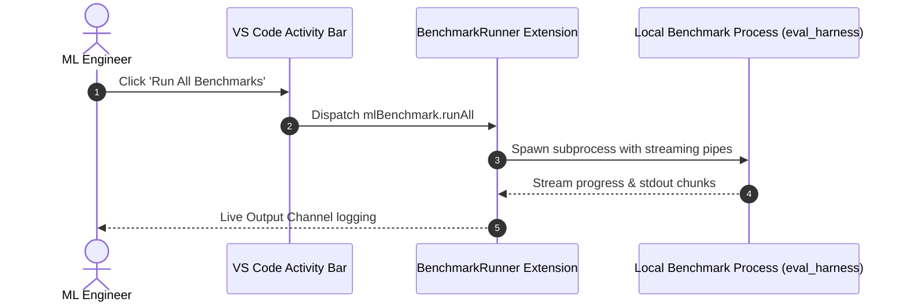

# vscode-ml-benchmark-runner

A modern VS Code extension engineered for ML engineers and researchers to run, monitor, and visualize local LLM and VLM benchmarks directly from their development environment.

---

## Architecture

---

## Features

- **Activity Bar Integration:** Inspect available benchmark suites (GSM8K, MMLU, HumanEval, Latency Profiler) directly in the sidebar.
- **Streaming Output Terminal:** Real-time stdout capture without blocking editor threads.
- **Visual Webview Dashboard:** Polished metrics display highlighting accuracy, TTFT (Time-to-First-Token), and pass rates.

---

## License

MIT License (c) 2024 Soujanya Gupta.

<!-- PR #6: docs: clarify benchmark metric configuration options -->
